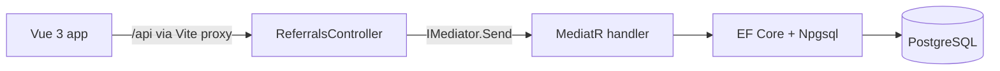

# ReferralDemo

A small home health referral service: search patients, check a patient's referral and how urgent it is, and schedule a visit. Built to work hands-on with a .NET, PostgreSQL, Vue, and VB.NET stack.

All data is seeded sample data. No real patient information is used anywhere in this project.

## Stack

| Layer | Technology |
| --- | --- |
| UI | Vue 3, TypeScript, Pinia, Vue Router, Vite |
| API | ASP.NET Core 10, controllers, Swagger |
| Application | MediatR (CQRS: queries and commands) |
| Business rules | VB.NET class library with its own MediatR handler |
| Data | EF Core 10, Npgsql, snake_case naming, migrations |
| Database | PostgreSQL 16 |
| Observability | OpenTelemetry tracing |
| Tests | xUnit, Testcontainers (real PostgreSQL), FakeTimeProvider |
| CI | GitHub Actions: .NET build and tests, Vue type-check and build, Docker image build |

## How a request flows



Controllers stay thin and send each request through MediatR. A validation pipeline behavior runs the request's FluentValidation validators first; failures come back as a 400 with a `ValidationProblemDetails` body listing the errors per field. Each handler is one use case with its own OpenTelemetry span. Reads skip change tracking; the write commits through `SaveChangesAsync`. The request's `CancellationToken` flows from the controller through MediatR to EF Core, so an abandoned request stops its database query.

## Projects

```
.github/workflows/ci.yml   CI pipeline
global.json                Pins the .NET SDK for local builds and CI
Dockerfile                 Multi-stage image for the API
ReferralDemo/              ASP.NET Core API (C#)
ReferralDemo.Rules/        Referral rules and summary handler (VB.NET)
ReferralDemo.Tests/        xUnit tests (C#)
referral-ui/               Vue 3 front end
```

## API

| Method | Route | Description |
| --- | --- | --- |
| GET | `/api/referrals/search?name=&status=` | Search patients (case-insensitive name match) |
| GET | `/api/referrals/{patientId}/status` | A patient's referral, or 404 |
| GET | `/api/referrals/{patientId}/summary` | Referral with days until due and urgency (VB.NET handler) |
| POST | `/api/referrals/schedule-visit` | Schedule a visit; returns the new visit ID |

## Running locally

Prerequisites: .NET 10 SDK, Docker, and Node.js 22.

**1. Start PostgreSQL**

```
docker run --name pg -e POSTGRES_PASSWORD=devpass -p 5432:5432 -d postgres:16
```

**2. Create the database and seed data**

```
dotnet tool install --global dotnet-ef
dotnet ef database update --project ReferralDemo
```

**3. Run the API** (Swagger at http://localhost:5000/swagger)

```
$env:ASPNETCORE_ENVIRONMENT = "Development"
dotnet run --project ReferralDemo
```

**4. Run the UI** (http://localhost:5173)

```
cd referral-ui
npm install
npm run dev
```

The Vite dev server proxies `/api` to the API on port 5000, so no CORS setup is needed in development.

## Tests

```
dotnet test ReferralDemo.Tests
```

- **Integration tests** run the handlers against a real PostgreSQL container started by Testcontainers, using the same migrations as the app. Docker must be running.
- **Unit tests** cover the VB.NET rules and summary handler with a fake reader and a fixed clock. They need nothing external:

```
dotnet test ReferralDemo.Tests --filter "FullyQualifiedName~ReferralRules|FullyQualifiedName~GetReferralSummary"
```

## Container

```
docker build -t referral-api .
docker run --rm -p 8080:8080 -e ConnectionStrings__Referrals="Host=host.docker.internal;Port=5432;Database=cqrs;Username=postgres;Password=devpass" referral-api
```

The connection string comes from an environment variable, the same way a secret manager would supply it in a cloud deployment.

## Design notes

- **Testing against real PostgreSQL.** The EF Core in-memory provider and SQLite can't run `EF.Functions.ILike` or enforce PostgreSQL's UTC-only `timestamptz`, so they would pass tests that fail in production.
- **PostgreSQL differences handled:** case-sensitive identifiers (snake_case naming), case-insensitive search with `ILIKE`, UTC timestamps for visits, and a `date` column for due dates.
- **C# and VB.NET together.** The VB.NET library defines `IReferralReader`; the C# API implements it with EF Core. Business rules don't depend on the data layer, and the library avoids a circular reference to the API project.
- **Testable time.** Handlers take a `TimeProvider` instead of reading the clock directly, so tests can fix "today."
- **Missing due dates** are modeled as their own urgency state rather than defaulted or cast away.

## What I'd add next

- A foreign key from visits to patients
- EF Core instrumentation so SQL queries appear as spans
- Docker Compose for the full stack, and a deployment to Cloud Run with Cloud SQL

## How it was built

Developed with Claude Code as a pair programmer. Every change was reviewed, built, and tested before it was committed.
